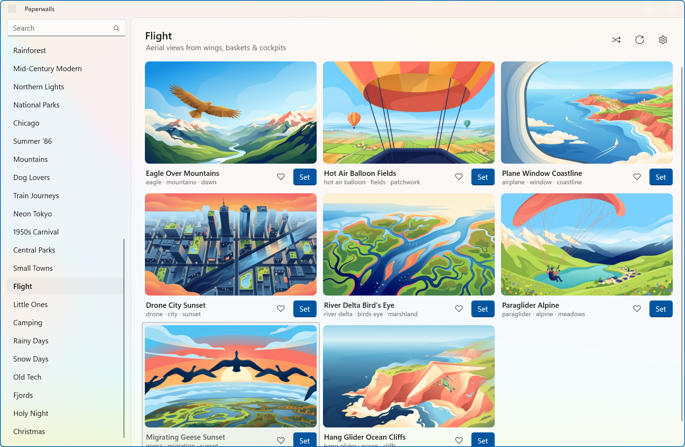

# Paperwalls for Windows

Browse and set wallpapers from [Paper](https://burkeholland.github.io/paper/). WinUI 3 + C#, packaged as MSIX with [winapp](https://github.com/microsoft/WinAppCli).



## Run

```powershell
winget install Microsoft.WinAppCli
winapp run .            # build, register with identity, launch
```

## Package

```powershell
winapp cert generate                                   # once, dev only
winapp package .\Paperwalls.csproj --cert devcert.pfx --arch arm64 --arch x64
winapp package .\Paperwalls.csproj --no-sign --arch arm64 --arch x64   # Store upload
```

Installing the dev-signed bundle needs `winapp cert install devcert.pfx` (admin) first.

## Notes

- Catalog: `https://burkeholland.github.io/paper/api.json`, cached for offline use.
- Sets the wallpaper on every monitor through `IDesktopWallpaper` (Fill).
- Data lives in the package's LocalState: catalog, favorites, rotation settings and a 750 MB image cache.
- WindowsAppSDK is pinned to 2.6.5 because the internal NuGet feed lacks 2.7's AI package.
